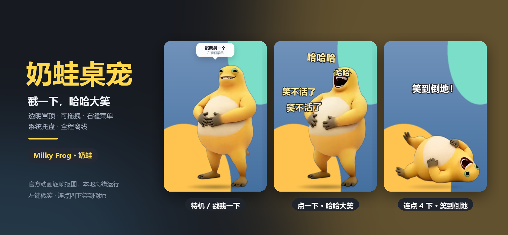

# 奶蛙桌宠



一只趴在 Windows 桌面上的奶蛙：**左键戳它，它会哈哈大笑**——嘴巴张开、身体乱颤，还带原声笑声。连戳四下，它会笑到倒地，过一会儿再自己爬起来。

## 开源说明

这个仓库开放的是**代码和素材生成工具**。奶蛙的角色、动画和声音版权属于原作者，所以仓库不包含 `pet/` 里的成品动画，也不包含 `assets/source/` 里的官方视频；这两处都已加入 `.gitignore`。第一次运行请按下面的「快速开始」从官网演示生成素材。

代码以 MIT 许可开源；角色素材的使用限制见文末「版权」。

## 奶蛙是什么

搜了一圈，你说的“奶娃”应该是 **奶蛙（Milky Frog）** 的谐音。官网 [milkyfrog.com](https://milkyfrog.com/) 给它的设定是“戳一下就狂笑的招财金蛙”，和“点击就哈哈大笑”的需求正好对上。

网上流传的多是二次创作表情包。为了保证清晰度和动作完整，这只桌宠没有使用压缩过的 GIF，而是从官网公开的 720×1122 大笑演示视频里截取动作，逐帧 AI 抠图后做成透明动画；同时保留 `laugh.gif` 作为解码失败时的备用。

## 快速开始

前置：Windows 10/11 x64、Node 18+、Python 3.13、ffmpeg 在 PATH。

> rembg 依赖的 onnxruntime 目前没有 Python 3.15 的 wheel，请用 Python 3.13。Windows 下可以用 `py -3.13`，或者直接把 Python 3.13 的 `python.exe` 路径写进命令。

```bash
npm install

# 1. 下载官方演示视频与封面（约 800 KB）
py -3.13 tools/fetch_source.py

# 2. 安装抠图依赖（首次会下载 u2net 模型，约 176 MB）
py -3.13 -m pip install rembg onnxruntime pillow numpy

# 3. 抽帧、抠图、编码，生成 pet/ 下的素材
py -3.13 tools/build_assets.py

# 4. 启动
npm start
```

打包成双击运行的 exe：

```bash
npm run pack
```

产物在 `dist\奶蛙-win32-x64\奶蛙.exe`，之后可以双击根目录的 `启动奶蛙.vbs`。打包版约 360 MB，主要是 Electron 运行时；因为体积和素材版权原因，不放进仓库。第一次运行打包出的 exe，Windows 可能提示“未知发布者”，点“更多信息 → 仍要运行”即可（个人工具没有代码签名）。

> 如果首次安装时 Electron 二进制没下载下来，执行 `node node_modules/electron/install.js` 补下。
>
> 如果 `fetch_source.py` 因为官网改版失败，可以手动打开 https://milkyfrog.com/ ，把首页演示视频另存为 `assets/source/milky-frog.mp4`（封面可选），再运行 `build_assets.py`。

## 操作

| 操作 | 效果 |
| --- | --- |
| 左键点一下 | 哈哈大笑：透明动画 + 原声笑声音效 + 飘出“哈哈哈” |
| 连点 4 下 | 彩蛋：笑到倒地，停一会儿自己爬起来 |
| 按住拖动 | 移动位置，退出后记住 |
| 右键 | 菜单：笑声开关 / 总在最前 / 小·中·大三档 / 回到右下角 / 退出 |
| 托盘图标 | 显示隐藏、戳一下、静音、置顶、退出 |
| Esc | 关闭右键菜单 |

## 实现

- Electron 透明无边框窗口：`transparent` + `frame:false` + `alwaysOnTop`，不占任务栏，尺寸随“小/中/大”缩放。
- 点击与拖动用 Pointer Events 区分：位移超过 5px 算拖拽，否则算点击；主进程按屏幕坐标移动窗口并持久化位置。
- 动画是带 alpha 的 VP9 WebM（`yuva420p`），内含 Opus 音轨，Chromium 原生支持。点按时把 `currentTime` 归零再 `play()`，播放结束淡出回静态待机图。
- 万一 WebM 解码失败，自动回退到 `pet/laugh.gif` + `pet/laugh.mp3`。
- 统计大笑期间的点击次数，第 4 次切到“笑倒”片段。
- 设置和窗口位置保存在 `%APPDATA%\奶蛙\pet-state.json`。
- 程序运行时不联网、无广告、无遥测。

## 素材流水线

```text
tools/fetch_source.py  →  assets/source/milky-frog.mp4
        │  ffmpeg 抽帧（24fps）
        ├── 待机帧 12.1s
        ├── 大笑 1.55–5.85s（收在音轨的句间停顿处）
        └── 笑倒 11.95–17.45s
                 │  rembg(u2net) 逐帧抠图
                 │  全片段共用裁剪框 638×834，切换时角色不跳动
                 ├── pet/idle.png
                 ├── pet/laugh.webm  (VP9 alpha + Opus)
                 ├── pet/fall.webm
                 ├── pet/laugh.gif   (1-bit 透明，备用)
                 └── pet/laugh.mp3
```

重建素材（需要 Python 3.13、ffmpeg 在 PATH）：

```bash
py -3.13 -m pip install rembg onnxruntime pillow numpy
py -3.13 tools/build_assets.py
```

- `tools/build_assets.py`：完整流程。首次会下载 u2net 模型（约 176 MB）；中间帧缓存在 `assets/.build/`，删掉即可强制重新抠图。
- `tools/make_icon.py`：从待机图生成 `pet/icon.png` 和 `.ico`。
- `tools/make_banner.py`：用冒烟测试截图拼预览图。

## 冒烟测试

先完成素材生成，然后：

```bash
npm run smoke
```

会自动启动窗口、截图，并模拟待机、点击、右键、连点笑倒、拖拽和缩放，结果写进 `smoke/result.json`。打包版也能测：

```bat
dist\奶蛙-win32-x64\奶蛙.exe --smoke
```

结果写到 `%TEMP%\naiwa-smoke\`。

## 目录

```text
main.js              主进程：窗口、托盘、拖拽、状态持久化
preload.js           contextBridge 暴露的最小 IPC
renderer/            透明界面、点击逻辑、右键菜单、飘字
pet/                 生成的素材（仓库里只有 README）
assets/source/       官方视频与封面（仓库里只有 README）
tools/               fetch_source / build_assets / make_icon / make_banner
screenshots/         README 预览图
dist/                本地打包产物（不入库）
启动奶蛙.vbs / .cmd  双击启动
```

## 版权

- 奶蛙 / Milky Frog 的角色、动画、声音版权归原作者所有。本仓库**不包含**这些素材；`screenshots/` 中的截图仅用于展示本项目效果。
- 本项目与奶蛙官方无关，是非商业的同人作品，请勿把素材用于商业用途。如原作者认为本项目不妥，请联系删除。
- 本项目代码以 [MIT](LICENSE) 许可发布。
- 用到的开源工具：Electron、rembg / u2net、ffmpeg、Pillow、NumPy。

欢迎 issue 和 PR。
